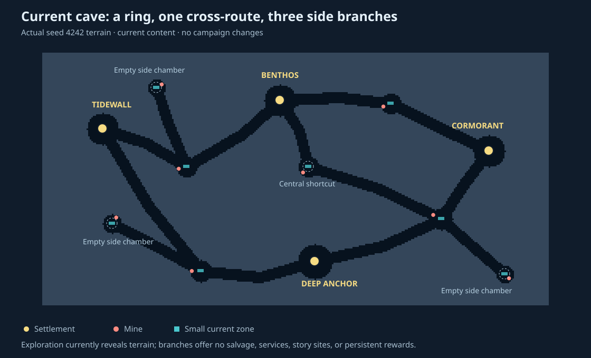
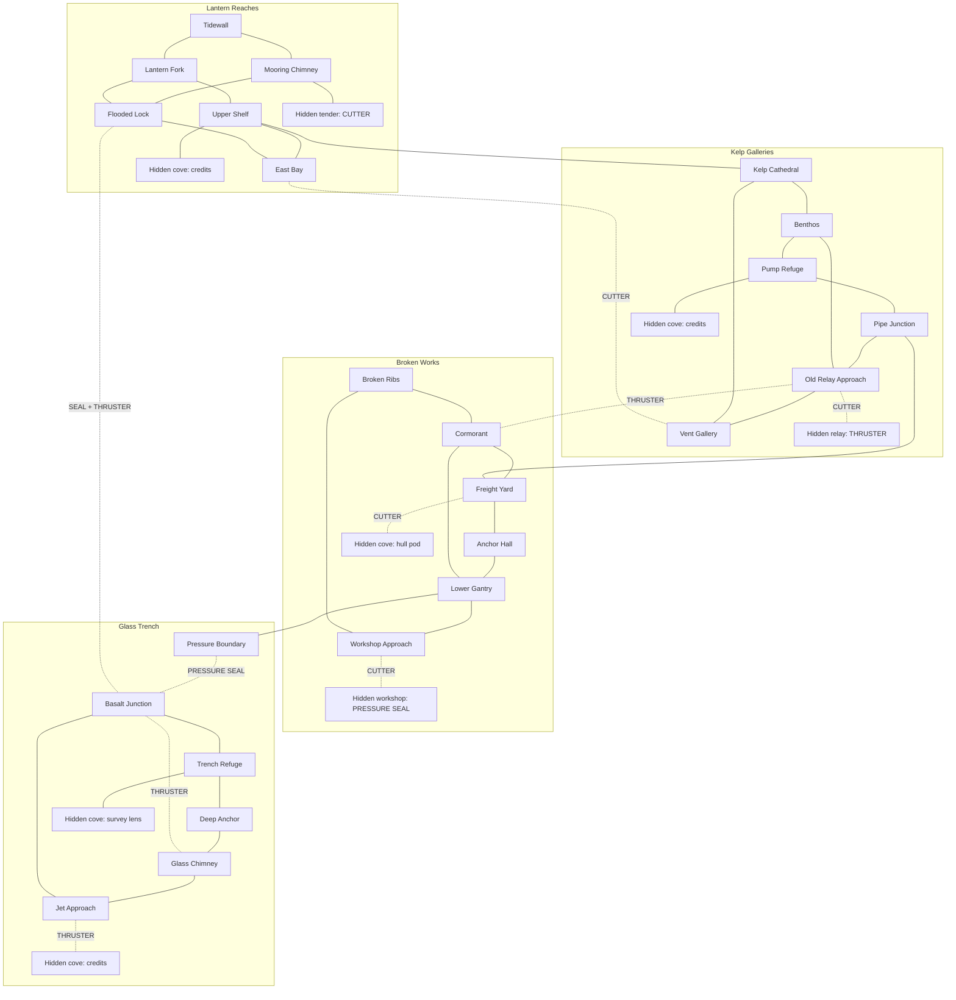

# Exploration and campaign proposal

Campaign draft, 2026-10-24; playable map implementation added 2026-10-25.
The authored map, equipment gates and eight cove rewards are now implemented;
see [the active level format and behavior](../levels/README.md). Campaign
restoration missions, the ending and persistent voyage checkpoints remain
proposals. Exact encoded geometry is shown in the generated terrain preview.
The active map now has winding passages, asymmetric caverns and 31 physical
rock features. High-pressure water remains lowest, with equipment dependencies
validated against actual hull clearance. The legacy-map critique below records
the starting point for this proposal.
Revised 2026-10-24 following the request for a more complex map, paths opened
by upgrades, and hidden coves containing equipment and money.
Tone is provisionally curious and welcoming, with tense deep-water expeditions,
pending player preference. Platform facts remain canonical in `platform.md`.

## Experience to build

The player should leave a familiar harbor with a purpose, spot something that
invites a detour, make a decision about the trip, and return with a more useful
mental map. Eventually their hauling restores the settlements' supply network.

Progress has four forms: discovering places, finding equipment that opens
paths, learning better routes, and restoring settlements. The ending pays off
all four. Exploration must remain worthwhile before and after a contract is
completed. Some equipment is found in coves and wrecks; hauling earns money
to improve the boat between expeditions.

## What the legacy map provided

`tools/gen_world.py::generate_cave()` builds four settlements on a ring of
eight chambers, a central two-link shortcut through a ninth chamber, and three
dead-end branches. The twelve authored chamber centers mostly become similar
disks connected by similarly wide, wiggling tunnels. Accidental intersections
in the carved terrain can differ from the intended chamber graph.

The three side chambers currently contain no discovery reward or service.
Mines and small current rectangles are distributed among non-station chambers.
The tile renderer uses one rock treatment and one station silhouette. There
are no authored wrecks, landmarks, shelters, caches, or world changes.

Fog records where the player has been. Sonar reveals a square of coarse chart
cells, including across intervening rock; it does not identify interesting
contacts. The chart has 40-pixel cells and renders each as 2x2 screen pixels.
Its any-open-tile downsample can visually merge passages separated by rock.
The chart should support orientation rather than promise collision clearance.

Ordinary contracts start deadlines as soon as travel begins. A player who
spots a branch while loaded has a reason to ignore it. Route rewards and
deadlines use straight-line station distance, not navigable distance or turns.

## World shape: interlocking regions and equipment gates

[Open the proposed exploration map SVG](assets/proposed-exploration-map.svg).
It shows every planned room, cove, gate and regional connection, with all
secrets visible for design review.

Build four regional networks with about 24 main locations and 8 hidden coves
as an initial content target. Each region has multiple junctions, at least two
local circuits, vertical and horizontal routes, and recognizable landmarks.
Cross-region connections create longer loops as equipment opens the map.
This is a substantial redesign of the current twelve-chamber cave.

Depth increases downward in the spatial map. Lantern Reaches and Kelp
Galleries occupy the upper water, Broken Works lies below them, and the
high-pressure Glass Trench occupies the lowest band. Deep Anchor sits at the
bottom. The pressure-seal pickup is above that band; both the main descent
and the return shaft cross a clearly marked pressure boundary before entering
the trench. No high-pressure route sits beside an upper-water region at the
same depth.

Keep four settlements. Determine the final tile dimensions from the room and
route design: the current dimensions are a starting point, not a restriction
that forces cramped rooms or unreadable junctions. Author the topology before
carving terrain; random wiggle must not create accidental gate bypasses.

| Region | Terrain and navigation | Equipment discoveries | Routes to remember |
| --- | --- | --- | --- |
| Tidewall / Lantern Reaches | Bays, mooring chimneys, a flooded lock and several reconnecting passages | Salvage cutter in the abandoned tender; credit cache in a tucked-away cove | Several grated openings seen before the cutter; a lock passage into Benthos |
| Benthos / Kelp Galleries | Tall chambers, shelves, a pipe network and a pump refuge | Current thruster in the old relay; money in a silt pocket | Cutter opens the relay and pipe bypass; thruster opens a fast connection to Cormorant |
| Cormorant / Broken Works | Wreck ribs, yards and enclosed industrial spaces | Pressure seal in a workshop; permanent hull pod in a wreck cove | Workshop requires the cutter; pressure boundary leads into the deep region |
| Deep Anchor / Glass Trench | Dark shafts, open basalt chambers, jet passages and refuges | Optional survey lens and a substantial credit cache | Pressure seal opens the region; thruster opens a shorter jet route and another return connection |

The SVG places all regions in one continuous spatial network. The route
inventory below matches its visible passages. Solid links are base-equipment
passages; labeled dashed links require equipment. Cove locations are shown
for design review and remain concealed at the start of play.

This proposed graph has 24 main locations and 8 coves. Its regional circuits
support route choice before the first tool, and cross-links make older areas
useful again after acquiring equipment. Specific room counts and placements
can change during the spatial layout pass; a large number of rooms alone is
not the acceptance criterion.

## Equipment that changes where you can go

Use three new capability tools, distinct from existing shop stat upgrades.
Acquiring a tool grants its capability immediately; a mandatory tool never
requires paying an additional installation fee.

| Tool | Acquisition | Physical gate | Payoff beyond the next objective |
| --- | --- | --- | --- |
| Salvage cutter | Hidden tender in Lantern Reaches, reachable with the starting boat | Clearly drawn grates and light bulkheads | Several remembered openings become usable, including two equipment coves, optional salvage and a regional shortcut |
| Pressure seal | Workshop behind a cutter gate in Broken Works | Marked high-pressure boundaries | Opens the deep region, refuge, optional coves and the final campaign destination |
| Current thruster | Old relay behind a cutter gate in Kelp Galleries | Clearly telegraphed opposing jets | Opens fast freight routes, a hidden credit cove and a long return connection |

The acquisition dependency is **starting boat -> cutter -> pressure seal and
thruster in either order**. The pressure seal is required for the ending. The
thruster is an optional route-changing tool with enough shortcuts and treasure
to be worth seeking; the longer deep route remains completable without it.
No tool is behind its own gate. No gate depends on the selected cosmetic hull.

Show the player one blocked grate before they find the cutter. On obtaining
the cutter, briefly show its symbol and purpose; the chart keeps symbols on
previously encountered gates. Each main tool should have at least three useful
applications across the world, including a return visit to a familiar region.

Gate semantics must be physical and fair:

- A cutter gate opens after a short, low-speed operation at its visible ring.
  Opened gates stay open in the saved voyage and work in both directions.
- A pressure boundary has a recognizable warning structure and a safe lip
  where the boat can stop and retreat. Without the seal it blocks passage;
  it does not kill the boat as an unexplained depth threshold. Surveying the
  boundary is possible before owning the seal.
- A jet is readable from an approach chamber. Without the thruster the
  current prevents forward progress while leaving room to retreat. With the
  thruster the boat has enough effective thrust to traverse it. This requires
  real movement-rule support; the existing tiny current rectangles do not
  already implement an upgrade gate. Validate both travel directions.

The return connection from Basalt Junction to Flooded Lock cannot bypass the pressure
boundary: it requires the thruster, which also requires a deep-pressure permit
on this particular cross-region gate. In implementation, give that edge an
explicit combined PRESSURE_SEAL + THRUSTER requirement. The other thruster
shortcuts remain available before acquiring the pressure seal.

Equipment gating is separate from station repairs. Repairs create services
and conveniences; equipment enables physical passages. A player can explore
ahead of campaign requests when their tools permit it.

## Hidden coves with tangible rewards

Build eight coves in the first full map: three contain the capability tools,
three contain credit caches, one a permanent hull pod, and one an optional
survey lens. Additional small air or repair caches can be placed along routes
after the main discoveries prove worthwhile. The campaign never requires
finding all coves or collecting a percentage of the map.

A hidden cove should be concealed by layout and readable clues: a passage
behind a large wreck rib, an opening above the normal camera line, or a narrow
branch beside a distinctive pipe. Do not require pressing against every wall,
finding a single indistinguishable tile, or crossing fake solid collision art.
Mandatory tool coves get at least two clues: an environmental cue and a station
rumor or nearby sonar contact. An ordinary sonar can locate required tools;
the optional lens only improves detection of extra caches and story contacts.

Money is a substantial exploration reward. Initial tuning targets for the
three hidden purses are 40, 90 and 150 credits, increasing with access and
risk. These are proposed amounts, not changes to the current game. Tune against
shop costs so the first find advances a purchase and a gated late cache can
buy a meaningful upgrade. Hidden equipment and capacity pods grant the actual
upgrade, rather than another generic currency token.

Separate tool ownership, found pod bonuses and purchased stat levels in the
rules. A hull pod permanently adds capacity within a defined cap; the shop
shows the combined capacity. A pod must still benefit a player who already
maxed purchased hull levels. Never silently consume a find for zero benefit.
The survey lens is found equipment with a specific optional-contact benefit,
not an extra prerequisite for finding the pressure seal.

Retain useful spending after discoveries: rising per-level shop costs and
campaign-paced stock are candidates for tuning. Do not assume the current
540-credit total remains appropriate once exploration also supplies money.
Budget expected mandatory-delivery income and find income together; do not
require grinding express work to afford the required campaign capabilities.

## Navigation and expedition pace

Campaign deliveries and ordinary freight are untimed. Optional express jobs
have clear deadlines and premium payment. Air, cargo, unfamiliar passages and
hazards make detours consequential without punishing every act of curiosity.
Use untimed, empty-boat exploration trips as a worthwhile option between jobs.

Keep a compact chart vocabulary: stations, services, unknown contacts,
identified finds, encountered gates and the current objective. Distinguish
closed gates from opened ones and unclaimed finds from completed ones. A new
tool makes remembered gates visibly usable; unexplored geometry stays hidden.
The current 2x2-pixel-per-cell chart needs a readability prototype for these
markers. Prefer showing a selected marker's label separately over overlapping
many icons; do not promise every category fits in three pixels.

Sonar can detect nearby unknown contacts without drawing their full route.
Approaching identifies a contact. Required clues remain visible with sound
muted. Keep flight A as sonar, B as the chart, and station controls intact.
Use low-speed dwell rings for pickups and cutter operations, with separate
eligibility rules and leave/reenter latches to prevent repeated rewards.

A base tank has 180 units, passive drain is 0.6 units/s, blowing costs more air,
and the fully loaded horizontal speed cap is 18 px/s. Validate routes for
actual loaded movement, rises, maneuvering, and an achievable retreat or refuge.
Express deadlines must use navigable travel time rather than straight-line
station distance. New loops should save meaningful travel or offer a genuinely
different hazard/air tradeoff; decorative bends alone do not add depth.

## Campaign and ending

Target six to eight main objectives, allowing equipment discoveries to occur
between them or ahead of requests. The sequence is a partial order, not a
linear tour of every room:

1. **First delivery.** Tidewall to Benthos, past a memorable grated opening
   and a clue to the tender. The cutter can be found before or after this job.
2. **Open the old routes.** Discover the cutter, revisit a grate, and reach
   either the old relay or the workshop. Station requests provide clues if
   needed. No delivery-count threshold substitutes for finding the tool.
3. **Reconnect settlements.** Repair Benthos's pump and Cormorant's freight
   lift through survey and supply objectives, in either order. They provide
   checkpoint services and useful freight connections. Seek the thruster and
   pressure seal in either order while completing this work.
4. **Enter the deep region.** The pressure seal enables a new region, where
   the player can find a refuge and extra rewards before the final delivery.
   The longer route is viable without the optional thruster.
5. **Restore Deep Anchor.** After both settlement repairs, carry the core to
   the deep station. Light its beacon and establish a new checkpoint.
6. **Homecoming.** Return its first network dispatch to Tidewall, using the
   routes and tools learned along the way. Show the restored network, a brief
   ending and voyage statistics; allow continued exploration afterward.

Show the active purpose and a relevant clue on station boards. Opening paths,
claiming finds and repairing stations visibly change the world. Equipment
found ahead of its associated request is recognized, never confiscated or
required to be collected again. Completing the game requires the cutter,
pressure seal and campaign work, but not every stat upgrade, optional tool,
cache or story fragment.

Music supports the regions and journey: Harbor Bubbles at Tidewall, Kelp Drift
in the galleries, Bubblejet Run around the works and jets, Sonar Lullaby on
uncertain passages, Abyssal Glass in the trench, Tidepool Waltz at smaller
services. These assignments await a future gameplay music player.

## Saving, failure, and fair recovery

Save the voyage at serviced berths: campaign milestones, credits, upgrades,
tool ownership, found pod bonuses, opened gates, last safe berth, exploration
and discovery state, and active contract/cargo.
An active timed contract's remaining flight time must not reset on reload.
Checkpoint both accepting a contract and departing, not only arriving.

For the first version, wrecking or invoking rescue reloads the berth checkpoint
and explicitly warns that unsaved expedition gains are lost. A freshly restored
station checkpoints before the ending or next objective. Offer rescue from the
pause screen so zero air cannot leave the player stranded indefinitely. Do not
require a payment that could prevent recovery. A later design can preserve
more discovery knowledge after rescue if playtests justify the extra save rules.

Use one versioned voyage record rather than unrelated chart/economy saves.
One-time finds, consumed caches and opened shortcuts need stable IDs and flags
in that record. Reloading must never grant salvage twice. Prefer two bounded
EEPROM slots with sequence/checksum/commit handling, preserving the preceding
valid checkpoint on interrupted writes. A preliminary allocation of two
320-byte slots fits within the documented 1,024-byte EEPROM, but record size,
reserved addresses and existing chart-save migration require an implementation
audit. No extra 256-byte RAM map buffer should be introduced for serialization.

## First playable slice and acceptance

Build **Tidewall -> Lantern Fork -> Benthos** first, with the abandoned tender
and an interlocking network of roughly 10-12 places, including three coves.
The slice must demonstrate acquiring a capability and revisiting blocked
paths, as well as making a delivery. It is the test before building the other
regions, rather than a single corridor with one optional branch.

- Give the fork, mooring chimney, tender and Benthos distinct silhouettes.
- Place the cutter in a hidden but hinted cove reachable with base equipment.
- Show two closed cutter paths before acquisition: a regional shortcut and
  a passage to a rewarding credit cache. Both become usable with the tool.
- Include another base-accessible money cove so following curiosity pays off
  before the first equipment gate. Caches are one-time finds.
- Provide at least two local circuits and two routes with a real tradeoff.
- Use one untimed main delivery and one clearly labeled optional express job.
- Add persistent discovery markers, the first objective, a berth checkpoint,
  closed/open gate markers and explicit equipment/reward feedback.
- Revisit the same area after getting the cutter: the same geography must
  now offer new choices, a reward, and a shorter trip to a known destination.

Initial playtest targets, subject to revision:

- A first-time player can explain their destination and recognize a landmark
  without repeatedly checking a coordinate or reading a walkthrough.
- They notice an optional branch before passing it; at least one discovery
  occurs in the first few minutes without requiring a timer violation.
- They can find the cutter from its clues and explain which previously seen
  routes it opens. Encountered gates remain recognizable on the chart.
- Starting with no tools, all required equipment is obtainable. The first
  cutter cannot be hidden behind a cutter gate; money cannot be necessary to
  install a found capability tool.
- They can describe why they chose one route and what makes the other useful.
- Loaded base-equipment travel on the forgiving route leaves a reasonable
  recovery margin; ordinary mistakes do not require deliberate mine damage.
- Getting the cutter opens both demonstrated paths. The player finds a
  genuine credit reward and can return safely with it.
- A wrong turn leads to a clue, recognizable connection or manageable retreat.
- By Benthos, the player has seen a concrete world change and knows the next
  purpose. Replaying the same route feels more confident and efficient.

If the slice is dull, change room sequence, maneuvering, clues or payoffs
before adding more content. Confirm on-device readability and handling, not
only a zoomed-out map image.

## Implementation boundaries and verification

This document is a proposal, not a measured fit or an implementation order
authorized by itself. Keep pure rules Arduino-free, stable object IDs and
small progress masks. Keep tool bits, pickup bits, gate bits and stat bonuses
distinct. Author gates as bounded collision/current/pressure rules, not a
single optional visual overlay. Stream authored content/art/text from FX; measure any
new decoder/player and state cost separately.

Append a versioned replacement world and discovery data to the FX layout if
needed; do not reorder shipped declarations or change existing section sizes.
Generate through `make gen`. Bind chart saves to the world version so old
exploration cannot be applied to a different topology. Preserve documented
profile behavior, or explicitly design which campaign features each profile
includes before changing it.

The generator's current single-open-component check is insufficient for the
new map: it proves water connectivity, not passage by the 26x8 collision hull.
Validate routes using hull clearance, usable turning/approach space, intended
local loops and chart readability. Check reachability for every equipment
subset and each campaign gate state: required tools are reachable before
their own gates, the deep region has no accidental pre-seal bypass, and the
ending is possible without optional equipment or caches. Validate jet thrust
and pressure safety in device movement rules, not just the abstract graph.
Test trigger latches, one-time rewards, combined gate requirements, out-of-order
equipment discoveries, branch-order independence,
save interruption/migration, rescue and final-delivery idempotence. Host route
checks supplement, but cannot establish, enjoyable handling.

Before implementation, record a whole-image baseline. Each playable increment
needs the relevant native tests, generated determinism, device smoke suites,
whole-image flash/RAM measurements and stack reserve checks. Current planning
headroom is 128 bytes of static SRAM, so larger runtime collections are not a
safe assumption. Final gates follow `dev-flow.md` and `platform.md`.

The main unresolved choices are tone, how much exploration survives rescue,
and desired campaign duration. The recommendation here is to settle those
through the first slice rather than fix the entire map around untested timing.
