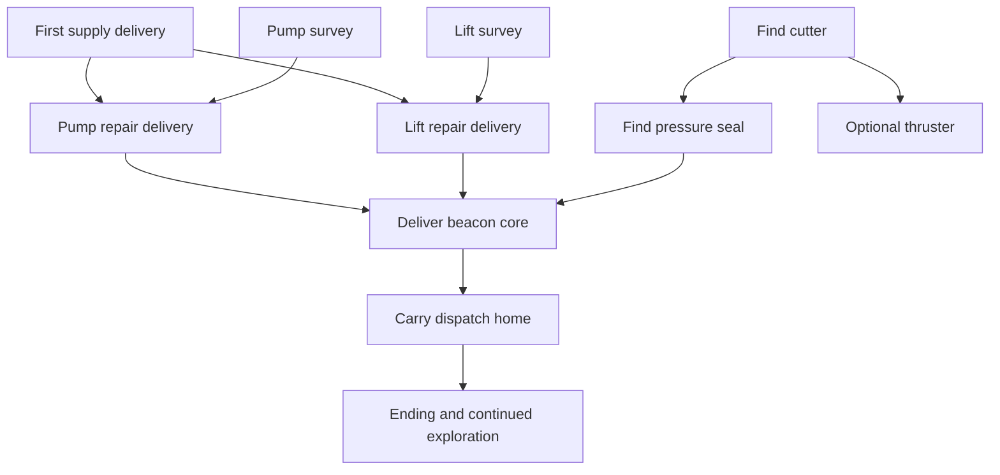

# Voyage progression design

Accepted implementation direction, 2026-10-26: **relaxed settlement restoration**.
The player approved this design and requested planning/dispatch through Gangway.
Execution was tracked under beads epic `sub-hauler-7px`; the `full` profile now
implements the campaign, ending, single-slot cart checkpoint and six-cue music
direction below. Dated measurements in [platform.md](platform.md) are canonical.
It refines the campaign, ending, saving and music sections of
[the exploration proposal](campaign-exploration.md). The existing map and
equipment remain the foundation; hardware and resource limits stay in
[platform.md](platform.md).

## The journey

You are the small freighter that can reconnect four isolated settlements.
Bring useful supplies, investigate what broke, open forgotten routes, and
watch the inhabited cutaways come back to life. The final trip carries news
home through a world whose routes you now understand.

Campaign work and repeatable freight have no deadlines and no clock. Air,
handling and hazards still make a journey an expedition. Wrecking or
requesting rescue retries the last berth checkpoint without a fee.

The main path needs the cutter and pressure seal. The thruster, survey lens,
capacity pod, credit caches and purchased upgrades remain optional. Discovery
can precede a request; repairs never remove tools or close explored routes.
Settlement repairs do not control access to equipment or regions.

Target a first voyage of roughly 90–150 minutes in 5–15 minute expeditions,
with longer late journeys split by intermediate stops. These are playtest
targets, not timings established by current route measurements. Finish the
first useful delivery in roughly 5–10 minutes. Tune routes and objective count
after measuring actual loaded travel; never accelerate the boat just to hit
the proposed duration.

## Seven main objectives

Five deliveries and two short field surveys form the campaign. Supplies are
specific in the fiction but use the existing four-unit load and handling.
The two repair branches can be completed in either order. Surveys are observed
facts, so a player can record them before the campaign asks for them.

| ID | Purpose and action | Becomes available | Completion and reward |
| --- | --- | --- | --- |
| FIRST | **Keep the grow rooms alive.** Carry filter supplies from Tidewall to Benthos. | New voyage; the board initially selects this offer but does not auto-accept. | Dock at Benthos loaded: 145 credits, first lamps illuminate, both repair requests become available. |
| PUMP_SURVEY | **Find the pump fault.** Inspect the marked pump in Pump Refuge. | Survey ring exists from the start; Benthos gives its clue after FIRST. | Slow dwell records a cracked impeller; Benthos board identifies Cormorant as the source of its replacement. No cash reward. |
| PUMP | **Bring water back.** Carry a replacement impeller from Cormorant to Benthos. | FIRST and PUMP_SURVEY; collect at Cormorant. | 85 credits; Benthos pump restored, grow-room service lights illuminate, Pump Refuge becomes a service berth. |
| LIFT_SURVEY | **Trace the broken lift.** Inspect the cable housing at Freight Yard. | Survey ring exists from the start; Cormorant gives its clue after FIRST. | Slow dwell records a ruined cable; Cormorant board identifies Benthos as the source of replacement fiber. No cash reward. |
| LIFT | **Move freight again.** Carry cable reels from Benthos to Cormorant. | FIRST and LIFT_SURVEY; collect at Benthos. | 85 credits; Cormorant lift restored, workshop lights and crane signal change, Lower Gantry becomes a service berth. |
| BEACON | **Light Deep Anchor.** Carry the assembled beacon core from Cormorant to Deep Anchor. | PUMP and LIFT complete, pressure seal owned. | 155 credits; Deep Anchor beacon and inhabited capsule lights illuminate. Save the restoration before showing its celebration. |
| HOME | **Bring the first reply home.** Carry Deep Anchor's network dispatch to Tidewall. | BEACON complete; explicitly accept at Deep Anchor. | 120 credits; Tidewall signal lights complete the network. Save completion before the ending. |

Payments use the current generated reward for each ordered route: 145 + 85 +
85 + 155 + 120 = **590 credits**. The values are initial design targets tied
to those routes, not a new duplicate economy table. A campaign delivery pays
once; it does not also resolve an ordinary freight reward.

The first payment affords an air level (60) and a hull level (70), with 15
credits left. Current shop levels total 540 credits; the existing three caches
add 280. All campaign work plus all credit caches therefore earns 870, before
optional freight. Keep current prices for the first slice and assess whether
later purchases arrive too quickly. Required work has no purchase or donation
cost. Never require grinding to buy a mandatory tool or finish a repair.

Each mission has a short reason and a person to help: Benthos is protecting
food crops, Cormorant wants its workshops moving, Deep Anchor has been working
without a reliable signal, and Tidewall is waiting for a reply. Use one or two
brief board messages, without adding dialogue trees.



The crossed repair deliveries make each settlement useful to the other.
For example: survey the pump, visit Cormorant and survey its lift, carry the
impeller to Benthos, then return with cable reels. Reversing those repairs is
equally valid. Finding the cutter, thruster or seal can interrupt this route
whenever curiosity suggests a detour. Early visits to Deep Anchor are welcome;
its board explains what the beacon needs without treating the player as out
of sequence.

Survey rings use the same low-speed, half-second dwell language as existing
finds. Their markers sit in navigable water beside the named landmark, not
inside baked rock artwork. They have stable IDs distinct from pickup/gate IDs,
give a short written finding, and cannot interfere with a nearby find or grate.
The optional lens is never necessary. If a survey was already recorded, its
request immediately shows the supply objective rather than demanding a repeat.

## Restoration changes the next expedition

All four settlement berths keep their existing free air and repair service
before restoration. A struggling settlement can still make a visitor safe.
Restoration adds forward service points and visible signs of recovery.

Pump Refuge and Lower Gantry gain **service-only berths** after their respective
repairs. Each refills air, repairs the hull and saves the voyage, including
loaded cargo. Neither generates freight, accepts deliveries or sells upgrades.
The network still has exactly four freight settlements. Use separate service
berth IDs rather than adding rows to the four-settlement economy matrix.

These are newly proposed docking points, not existing services. Author safe
approaches and foundations using the real hull-clearance rules; record them
in generated service metadata. Lower Gantry is above the pressure boundary.
Neither repair may put a mandatory tool behind its own gate. A service berth
that is not yet restored shows an inactive mooring and a readable repair clue.

The pump gives safer exploratory loops through the kelp region. The lift gives
a staging checkpoint near the descent to Deep Anchor. A player can finish
without relying on either new stop, but using them shortens retries and makes
long loaded expeditions more forgiving. Verify that claim with movement and
air budgets before implementation acceptance.

Use small native overlays for lamps, pump flow and beacon signals, derived
from repair flags. Existing inhabited rooms stay visible. No alternate full
world image or animated room simulation is needed. These overlays affect
neither collision nor chart water geometry.

## Offers, navigation and player choices

One cargo job can be active at a time, whether campaign or freight. Surveys
and tool discoveries do not occupy that slot. Acceptance loads the
four units and leaves the player docked; A on UNDOCK or B starts travel.
Stopping at any other berth retains the job and load. Arrival at the correct
settlement resolves a loaded campaign delivery automatically and exactly once.
Missing/short cargo cannot set completion or pay its reward.

Campaign offers have stable mission IDs and are independent of random offers.
Show eligible work at its collection station until completed. Abandoning
clears cargo and the active job, then saves that change. The original source
can supply the same mission again for free. Completion flags prevent repeat
payment. BEACON and HOME are distinct acceptances; never auto-load the return
dispatch or prevent a player from exploring empty.

The station board replaces both the redundant SERVICE row and the old freight
offer rows with a single WORK access. Keep WORK, SHOP and UNDOCK; automatic
service already happens on docking. WORK opens the one board used for all
restoration and optional freight. Eligible story restoration rows are listed
first in stable mission order, and the one repeatable freight row sits beneath
them. A accepts the selected row directly, auto-loading the four cargo units;
B returns to the station board. B undocks only on the top-level station board.
Builds without SHOP omit that row. Service-only berths use a smaller board.

The active-job board selects UNDOCK initially. ABANDON requires its own
confirmation and is never the initial selection after docking or Continue.
WORK remains accessible while carrying a job, but shows only the carrying
summary and cannot replace that load. The chart highlights the active delivery destination. With no
cargo, a player may select one known campaign target in WORK; this optional
focus is derived again after loading and need not be saved.

Use text lengths that fit the current 6x8 font (at most 20 characters per
line), for example this Benthos work page:

```text
BENTHOS WORK
PUMP: SURVEY NEEDED
LIFT: NEEDS CABLE

CHECK PUMP REFUGE
A DETAILS    B BACK
```

Clues identify an already known place or a nearby landmark rather than reveal
an unseen map corridor. If the cutter is missing, mention the old tender near
Tidewall. If both repairs are done but the seal is missing, point to the
workshop beyond the cutter grate. All relevant clues work with audio muted.
Core builds supply the same purpose and hints as text without a chart.

All freight is untimed. The WORK board offers one repeatable freight contract
selected deterministically by the saved offer cursor and paid at the generated
route reward; accepting or abandoning it refreshes the next row. Campaign work
receives the same ordinary route reward and is never combined with a freight
payment. A loaded arrival always pays, however long the trip took. There is no
express premium, deadline, clock, late failure or hidden timer. This is a
deliberate simplification: air and handling provide the expedition pressure.

## Checkpoints and rescue

One voyage slot appears as CONTINUE and NEW VOYAGE on the title screen.
Continue restores the last committed berth with full air/hull, zero velocity,
neutral trim for its load and its saved hull selection. NEW VOYAGE asks before
replacing an existing voyage and then uses the existing hull roster. No valid
save starts a new voyage; an incompatible save gives a clear message before
the player chooses to replace it. Developer mode never loads or writes saves.

Save on initial voyage creation, arrival at any active berth, accepted or
abandoned cargo, a successful shop purchase, and immediately before departure
when saved state changed. A delivery/repair arrival is one transaction:
resolve cargo, set its completion flag, credit the reward, activate services,
then commit. Only show SAVED after the write succeeds. During a write, freeze
simulation, pause music and ignore departure input. Resume the cue afterward.

The snapshot contains berth ID, hull class, credits, purchased levels, tools,
pickup claims (including the hull pod), open and seen gates, recorded surveys,
restoration milestones, visited-settlement bits, mine state, active job kind
and mission ID, its origin/destination/load/reward, offer generation state,
chart discovery, voyage time, delivered-job count and rescue count. No job
timer fields are stored. Store no pointers or raw C++ structure bytes. Transient physics, camera,
particles, dwell timers and notifications reset on load. The pod's capacity
is derived from its saved claim bit, as in the current rules.

Persist the deterministic board seed/cursor so reloading reproduces the same
freight offer without advancing its generation. There is no job age to preserve.
Schema 2 removes the timer fields; schema 1 voyage saves are explicitly
incompatible and are not migrated. Current schema 2 slots still receive full
magic, length, CRC and semantic validation, and a corrupt slot is never
partially applied.

The pause screen offers RESCUE with a confirmation: `RETURN TO LAST BERTH?`
and `UNSAVED FINDS LOST`. Wrecking offers RETRY BERTH or TITLE. Both rescue and
wreck recovery restore the complete snapshot, including chart and money;
unsaved tools, caches, opened gates and field surveys roll back together.
A player remembers the route even when unsaved chart cells disappear. Never
retain a claimed cache bit while rolling back its payout, or retain its payout
while restoring the cache. Zero air always has a free escape through RESCUE.
With a valid checkpoint, both recovery paths increment a saturating rescue
count and commit it before resuming, without changing credits or cargo. The
counter measures recovery requests, not attempts erased by a power failure.

Continue after a power-off also returns to the last berth; it is not a
midwater suspend save. No writes occur for pickups, sonar, chart closing,
per-frame autosaving or music progress. The HUD gives a brief `SAVED AT BERTH`
on departure and `UNSAVED FIND` on an expedition discovery. Do not display a
save indicator while unsaved gains exist.

### Storage and interrupted writes

Keep voyage bytes out of the system EEPROM prefix identified by
`EEPROM_STORAGE_SPACE_START` (16 in the installed Arduboy2). The implemented
fresh-voyage layout is one 4 KiB cart save block holding a single 512-byte
schema 4 record. A save erases the block, programs two 256-byte pages and writes
the commit byte last. A power interruption may lose the checkpoint; a torn
record is rejected and the title offers a clean New Voyage. No voyage byte uses
internal EEPROM.

Each slot has a 16-byte header, a 495-byte payload area and a final commit
byte. Header fields are magic (4), schema version (1), world layout version
(1), campaign content version (1), feature/profile signature (1), four
reserved/erased bytes, payload length (2) and CRC-16 (2). Cover header fields
other than the CRC
itself plus the used payload bytes with the checksum. Validate field ranges,
progress consistency and berth eligibility as well as the checksum. A refuge
checkpoint is valid only if its corresponding repair is complete.

The current full-profile chart needs 256 payload bytes, leaving 47 for scalar
state. The schema 2 scalar allocation totals 36 bytes: berth/class/credits (4),
shop levels (3), tools/claims (2), gate masks (4), milestones/surveys/visits (3),
job kind/ID/origin/destination/load/reward (6), offer cursor and
board seed (4), mines (1), voyage ticks (4), delivery and rescue counts (4),
ending-presentation flag (1). No job timer is stored. Confirm widths and
saturation rules before changing the schema again. A profile without a chart
omits that field and has a distinct signature. Cross-profile and cross-schema
loading is rejected until an explicit migration is implemented.

Write the older/inactive slot: invalidate its commit byte first, stream the
new payload directly from live state, write header/checksum, then set the
commit byte last. Re-read and validate before reporting success. Keep the
preceding slot intact. On boot choose the newest committed, compatible,
checksum-valid, schema/layout-compatible and semantically valid record. There
is no sequence or newest-slot comparison. Never allocate another chart-sized
RAM buffer; validate first, then decode directly into initialized state. A
failed save may lose the previous checkpoint because the single block was
erased; never load a torn record. Show `SAVE FAILED`; allow RETRY or explicitly
CONTINUE UNSAVED.

The existing optional chart writer uses addresses 0–259 and must be disabled
whenever voyage saving is built. Old chart bytes are never read or imported in
schema 2. A new voyage always starts with an empty chart; there is no keep-chart
prompt. The single slot is erased and rewritten. Never write system
addresses 0–15 or try to reconstruct system settings from old chart bytes.

An interrupted delivery save recovers either the complete pre-delivery
checkpoint (cargo still active, no payment) or the complete post-delivery
checkpoint (cargo cleared, payment and repair flag set). It never combines
those states. New-voyage replacement writes a newer checkpoint transaction;
do not erase both valid slots before writing it. A layout/schema mismatch
preserves data until an explicit replace choice.

## The ending and afterward

At Deep Anchor, the beacon supplies the climax: its signal turns on and a
short message arrives, `TIDEWALL CAN HEAR US`. It then offers HOME, rather than
ending the game immediately. The return lets the player use a remembered
route or an optional thruster shortcut; the longer seal-only route works.

Delivering HOME sets the completion flag and commits its payment before
showing three input-advanced cards: the lit four-station network, a short
thank-you from the settlements, and voyage statistics. Show time, discovered
coves out of eight and delivered jobs, derived from saved counters and masks.
Avoid a completion-percentage requirement or a perfect-run ranking.

An ending-presentation flag is separate from campaign completion. Mark it
after the cards. A reload between the final delivery and the cards resumes
the ending without repeating payment. If that final presentation write is
interrupted, showing the cards again is acceptable. Tidewall WORK offers
VIEW ENDING afterward.

CONTINUE VOYAGE returns to Tidewall's board with every tool, repair and reward
intact. Freight and remaining discoveries continue; completed
campaign cargo never respawns. There is no forced reset, rising hazard scale
or new-game-plus system in this first campaign.

## Music follows place and recovery

The user approved the sampled-audio resource implementation in
[`story-resource-design.md`](story-resource-design.md) on 2026-10-27. The six
score sources and cue behavior below remain authoritative; their admitted
offline-rendered ADPCM assets replace the proposed live-synthesis player.
The older decoder admission details below document the earlier approach and
are superseded by that resource design's sampled-player allocation and gates.

Music supports orientation and relief; it never carries essential clues.
Use the [six existing cues](../music/README.md), with a MUSIC ON/OFF option in
pause. Honor the device's audio setting; music has no per-voyage save field.
Use a settings allocation only after the EEPROM audit, separate from voyage
rollback. Sound effects are a later audio-ownership decision.

| Context | Cue | Rule |
| --- | --- | --- |
| Tidewall, Benthos and Cormorant boards; new-voyage title | Harbor Bubbles | Familiar home base, including visits before repairs. |
| Lantern Reaches travel | Sonar Lullaby | Curious, quiet departure. |
| Kelp Galleries travel | Kelp Drift | Broad, unhurried exploration. |
| Broken Works travel | Bubblejet Run | Industrial motion; it does not imply a timed objective. |
| Glass Trench travel and unrestored Deep Anchor board | Abyssal Glass | Distinct deep-water atmosphere. |
| Restored service berths, restored Deep Anchor board and ending | Tidepool Waltz | Relief and reconnection. |

Choose travel regions from authored room/route metadata, with deterministic
ownership for connecting passages. Do not use rough screen quadrants. An
offline coarse region plane or bounded room/route lookup is acceptable only
after measuring cost. A new region must remain selected for two seconds of
flight before replacing the cue, so crossing a boundary cannot restart songs
repeatedly. Docking and ending overrides switch immediately; same-cue entries
do not restart. Cut/restart between different cues initially; crossfades,
layered variants and newly composed victory stings are outside this draft.

Chart and pause freeze the current cue and resume it in place. Station/shop
idle frames continue music even when no OLED update occurs. Wreck/rescue
confirmation is silent; cancellation resumes the cue, successful recovery
starts the restored berth's cue. Saving pauses playback to avoid blocking a
stream refill while EEPROM is written. Continue chooses its berth cue from
world/progress state, not from a stored audio position.

The library's 64-byte ring is only one part of its SRAM cost. Spike the actual
full image with decoder, channels, timers and campaign/save state together;
the separate jukebox size cannot prove this game fits. Existing streams need
`ATM_FX_COMPACT_RING=64` and `ATM_FX_COMPACT_LOOP=1`; use generated FX symbols
and lengths. Service in foreground update after the preceding frame's completed
OLED transaction and before the next render/display; also service idle frames
without an OLED transaction. This keeps cart reads in update/render under the
existing device boundary. Measure the resulting refill interval against the
library's service deadline. Timer code must never read FX.
Verify 100 Hz Bubblejet Run under real rendering, chart, transitions and idle
menus. If combined SRAM or stack fails the canonical budgets, keep MUSIC
default off and report the measured deficit before proposing a specific carve.

## Implementation boundaries and acceptance

Proposed profile contract: full has campaign, voyage save and music once all
fit gates pass; lean/core have campaign and voyage save with music off; min
keeps its flight-only behavior. Campaign requires JOBS, STATIONS and EXPLORATION;
voyage save requires campaign. Standalone chart save and voyage save are
mutually exclusive. Core has no chart, sonar, shop or alternate hull roster;
every required survey and route must work with its base boat and visual clues.
These are proposed flags and defaults; no current profile changes here.

Keep campaign rules pure C++, with bounded masks and stable mission/survey/
berth IDs. Generate text, service metadata, region ownership and overlay assets
through `make gen`, appending FX declarations. Keep all old FX addresses and
object ordering. Do not serialize an AVR-dependent `State` layout or add a
runtime quest collection. Use input-driven, static menu composition.

Implementation order is resource/storage audit, pure campaign rules, atomic
voyage storage, checkpoint application integration, FIRST plus the pump branch
as one playable slice, lift/Deep Anchor/homecoming, music integration and final
verification. The dependent child issues under `sub-hauler-7px` define ownership
and acceptance. Compare whole-image measurements to the latest baseline in
platform.md before each increment.

Acceptance must demonstrate:

- Both repair orders, surveys and equipment found early, abandonment/reissue,
  wrong-berth stops, short cargo rejection and repeated docking. Mission
  rewards, cache rewards and ending payment are each exactly once per saved
  voyage history.
- Completion without the thruster, lens, pod, caches or shop upgrades
  income. Loaded route/air checks include the base core profile and achievable
  retreat or service stops; abstract room connectivity alone is insufficient.
- Two useful restored service berths with safe docking, no phantom freight
  destinations, readable restored overlays and matching checkpoint eligibility.
- Native-sized work pages, title/Continue, rescue, save failure and ending
  cards. No clipping, accidental abandon/departure, required sound clue or new
  flight button chord. Playtest the first-slice pace and detour incentives.
- Native C++ storage tests for every interrupted erase/page-write boundary,
  torn headers/commit, corrupt payloads, incompatible versions/profiles,
  invalid field combinations, ignored old chart bytes, repeated overwrite
  cycles and clean NEW VOYAGE recovery. System EEPROM bytes stay untouched. A
  torn record must never load or mutate live state; do not claim power-fail
  atomic rollback.
- Reload/rescue coverage for active freight and campaign loads at intermediate
  and restored berths; no timer state exists to reset
  stops, duplicate cash or stranded zero-air state. Confirm rollback notice
  matches what actually survives.
- Audio cue selection and boundary hysteresis, silence/resume rules, persistent
  mute and ring service through idle screens; all six cues loop without errors
  or underruns under combined device load. Listen on the actual speaker.
- Required repository gates from dev-flow.md, profile/Mini builds, whole-image
  flash/static measurements and the expanded stack probe. The full combined
  image must stay within the existing planning ceilings and stack target.
  Record timing with audio enabled, rather than reusing silent render figures.

The player accepted this progression as the planning baseline. Duration,
payouts and cue assignments remain tuning targets for first-slice playtesting;
physical berth placement and combined audio/save fit require measured checks.
