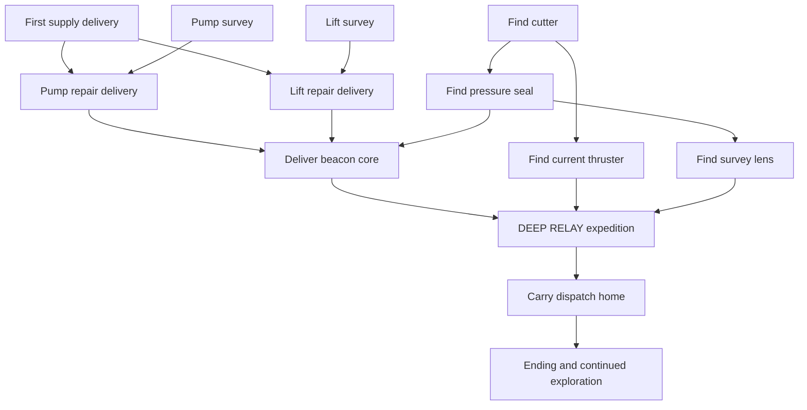

# Voyage progression design

Accepted implementation direction, 2026-10-26: **relaxed settlement restoration**.
The player approved this design and requested planning/dispatch through Gangway.
Execution was tracked under beads epic `sub-hauler-7px`; the fixed build now
implements the campaign, ending, single-slot cart checkpoint and six-cue music
direction below. Dated measurements in [platform.md](platform.md) are canonical.

Current implementation status (2026-11-03): the fixed build enables campaign,
schema 8 single-slot cart checkpoints and the ATMlib2FX compact synth; gameplay
sonar is retired, and mines and hull strength are removed. The eight
objectives, both service berths and the homecoming ending ship.

**Economy removal, 2026-11-01.** The upgrade shop, currency, job payouts,
repeatable freight offers and credit caches were removed after the 2026-10-31
design review. Air is a fixed 300-unit tank with the existing free berth refill
and free rescue; campaign deliveries are intrinsic restoration work and pay
nothing. The station board has no SHOP row, WORK lists only story and survey
rows, and schema 8 drops every currency, air-level, visited, reward and offer
field. Passages below that mention credits, prices, payouts or freight offers
are the accepted 2026-10-26 design record and describe behavior the fixed build
does not have.

Sections below retain the accepted design reasoning; where implementation
details changed, current behavior is stated inline and remaining proposal/history
is labelled. It refines the campaign, ending, saving
and music sections of [the exploration proposal](archive/campaign-exploration.md). The
existing map and equipment remain the foundation; hardware and resource limits
stay in [platform.md](platform.md).

## The journey

You are the small freighter that can reconnect four isolated settlements.
Bring useful supplies, investigate what broke, open forgotten routes, and
watch the inhabited cutaways come back to life. The final trip carries news
home through a world whose routes you now understand.

Campaign work has no deadline, clock or payment. Air and
handling still make a journey an expedition. Running out of air or requesting
rescue retries the last berth checkpoint without a fee.

## Buoyancy, cargo and air

Ballast runs from 0 to 100 on the gauge. Neutral trim for the current load is
`70 - 10 x cargo units`: 70 empty, then 60/50/40/30 at one to four units. The
40-unit empty-to-full delta keeps the loaded trim at 30 while giving an empty
boat a high, large blow reserve. Auto-load, berth service, undock and voyage
restore still set ballast to neutral for the load; cargo itself never moves
ballast, so an old trim feels heavy after loading.

Vertical speed limits scale with cargo: down `20 + 2 x cargo` px/s (20 empty
to 28 full), up `20 - 2 x cargo` px/s (20 empty to 12 full). A full hold
therefore sinks faster and climbs more slowly.

Blowing ballast costs a flat 3 air units per second for every load; flooding
stays free. The tank stays 300 units with the unchanged passive drain. A heavy
hold still spends more air over a climb: the lower up limit makes the ascent
longer, and a long climb needs more re-flood/re-blow cycles to keep lifting,
so the same flat rate runs for more seconds.

The main path needs the cutter, pressure seal, current thruster and survey
lens. The thruster disables every tide wall and opens the lower-right jet
route, while the lens reads the buried relay; both are required, with the
cutter and seal, for the mandatory DEEP RELAY expedition that precedes HOME. Discovery can precede a request;
repairs never remove tools or close explored routes. Settlement repairs do not
control access to equipment or regions.

Target a first voyage of roughly 90–150 minutes in 5–15 minute expeditions,
with longer late journeys split by intermediate stops. These are playtest
targets, not timings established by current route measurements. Finish the
first useful delivery in roughly 5–10 minutes. Tune routes and objective count
after measuring actual loaded travel; never accelerate the boat just to hit
the proposed duration.

## Eight main objectives

Six deliveries and two short field surveys form the campaign. Supplies are
specific in the fiction but use the existing story load and handling.
The two repair branches can be completed in either order. Surveys are observed
facts, so a player can record them before the campaign asks for them.

| ID | Purpose and action | Becomes available | Completion |
| --- | --- | --- | --- |
| FIRST | **Keep the grow rooms alive.** Carry filter supplies from Tidewall to Benthos. | New voyage; the board initially selects this offer but does not auto-accept. | Dock at Benthos loaded: first lamps illuminate, both repair requests become available. |
| PUMP_SURVEY | **Find the pump fault.** Inspect the marked pump in Pump Refuge. | Survey ring exists from the start; after FIRST, Benthos lists the survey as a non-cargo WORK quest. | Slow dwell records a cracked impeller; Benthos board identifies Cormorant as the source of its replacement. |
| PUMP | **Bring water back.** Carry a replacement impeller from Cormorant to Benthos. | FIRST and PUMP_SURVEY; collect at Cormorant. | Benthos pump restored, grow-room service lights illuminate, Pump Refuge becomes a service berth. |
| LIFT_SURVEY | **Trace the broken lift.** Inspect the cable housing at Freight Yard. | Survey ring exists from the start; after FIRST, Cormorant lists the survey as a non-cargo WORK quest. | Slow dwell records a ruined cable; Cormorant board identifies Benthos as the source of replacement fiber. |
| LIFT | **Move freight again.** Carry cable reels from Benthos to Cormorant. | FIRST and LIFT_SURVEY; collect at Benthos. | Cormorant lift restored, workshop lights and crane signal change, Lower Gantry becomes a service berth. |
| BEACON | **Light Deep Anchor.** Carry the assembled beacon core from Cormorant to Deep Anchor. | PUMP and LIFT complete, pressure seal owned. | Deep Anchor beacon and inhabited capsule lights illuminate. Save the restoration before showing its celebration. |
| DEEP RELAY | **Recover the buried relay.** Carry recovery cargo from Deep Anchor to the lower-right Deep Relay work site. | BEACON complete, cutter + pressure seal + thruster + survey lens owned; explicitly accept at Deep Anchor. | Dock at the Deep Relay wreck: the lens reads the buried relay and the expedition milestone commits. |
| HOME | **Bring the first reply home.** Carry Deep Anchor's network dispatch to Tidewall. | BEACON and DEEP RELAY complete; explicitly accept at Deep Anchor. | Tidewall signal lights complete the network. Save completion before the ending. |

Every delivery resolves once per saved voyage history and pays nothing.
Earlier accepted design targeted credit payouts of 145 + 85 + 85 + 155 + 120 =
590 credits and a 60-credit first air level against an 85-credit remainder (180
credits for three air levels plus 280 from three caches). Those tables, prices
and caches were removed on 2026-11-01 and no replacement income or purchase
exists.

Each mission has a short reason and a person to help: Benthos is protecting
food crops, Cormorant wants its workshops moving, Deep Anchor has been working
without a reliable signal, and Tidewall is waiting for a reply. Use one or two
brief board messages, without adding dialogue trees.



The crossed repair deliveries make each settlement useful to the other.
For example: survey the pump, visit Cormorant and survey its lift, carry the
impeller to Benthos, then return with cable reels. Reversing those repairs is
equally valid. Finding the cutter, thruster or seal can interrupt this route
whenever curiosity suggests a detour. Early visits to Deep Anchor are welcome;
its board explains what the beacon needs without treating the player as out
of sequence.

Survey rings use the same low-speed, half-second dwell language as existing
finds. Their markers sit in navigable water beside the named landmark, not
inside baked rock artwork. They have stable IDs distinct from pickup/gate IDs,
give a short written finding, and cannot interfere with a nearby find or grate.
The survey lens is not needed for the two field surveys; it is required later
to read the buried Deep Relay. If a survey was already recorded, its
request immediately shows the supply objective rather than demanding a repeat.
After FIRST, each unrecorded survey target also blinks as the same X used by an
active delivery, its in-world ring blinks, and a moving pilot inside the wider
approach radius sees the stop-to-survey notice. The clue berth also lists the
survey as a non-cargo WORK quest; selecting it opens the chart instead of
loading cargo. Recording the fact removes all four prompts.

WORK clues stay visible even when a berth has no currently acceptable row.
After either repair, the next-stop notice follows the unfinished branch
symmetrically: the missing survey first, then its repair source, then the
pressure seal. `BEACON CORE READY` is posted only after both repairs and the
seal exist, so lift-first and pump-first play cannot skip the other repair.
Six cargo acceptances also play a short departure briefing before travel; the
delivery result decks stay at their destinations. The joint-restoration scene
follows the second repair at whichever settlement received it.

## Restoration changes the next expedition

All four settlement berths keep their existing free air service
before restoration. A struggling settlement can still make a visitor safe.
Restoration adds forward service points and visible signs of recovery.

Pump Refuge and Lower Gantry are implemented as **service-only berths** after
their respective repairs. Each refills air and saves the
voyage, including loaded cargo. Neither generates work, accepts deliveries
or sells anything. The network still has exactly four settlements.
They use separate service berth IDs rather than adding rows to the
four-settlement berth list.

Safe approaches and foundations use the real hull-clearance rules and are
recorded in generated service metadata. Lower Gantry is above the pressure
boundary. Neither repair puts a mandatory tool behind its own gate. A service
berth that is not yet restored shows an inactive mooring and a readable repair
clue.

The pump gives safer exploratory loops through the kelp region. The lift gives
a staging checkpoint near the descent to Deep Anchor. A player can finish
without relying on either new stop, but using them shortens retries and makes
long loaded expeditions more forgiving; confirm the pace in playtesting.

Use small native overlays for lamps, pump flow and beacon signals, derived
from repair flags. Existing inhabited rooms stay visible. No alternate full
world image or animated room simulation is needed. These overlays affect
neither collision nor chart water geometry.

## Missions, navigation and player choices

One cargo job can be active at a time. Surveys
and tool discoveries do not occupy the active-job state. Acceptance loads the
story cargo and leaves the player docked; A on UNDOCK or B starts travel.
Stopping at any other berth retains the job and load. Arrival at the correct
settlement resolves a loaded campaign delivery automatically and exactly once.
Missing/short cargo cannot set completion.

Campaign missions have stable IDs; there are no random or repeatable offers.
Show eligible work at its collection station until completed. Abandoning
clears cargo and the active job, then saves that change. The original source
can supply the same mission again for free. Completion flags prevent a
second resolution. BEACON and HOME are distinct acceptances; never auto-load the return
dispatch or prevent a player from exploring empty.

The station board has a single WORK access. Current top-level rows are
`WORK / UNDOCK`; automatic service already happens on docking. WORK opens the
one board used for restoration and survey leads. All eight campaign objectives
have a WORK row: eligible story missions are listed in stable mission order. Survey
rows are non-cargo leads; A opens the chart with its blinking survey target
instead of loading the hold. Cargo rows auto-load the story cargo. B returns to
the station board. There is no detail page. B undocks only on the top-level
station board. Service-only berths use a smaller board showing UNDOCK alone.

The active-job board selects UNDOCK initially and shows
`summary / WORK / UNDOCK`. Mandatory story work has no abandonment row or
confirmation; the accepted load stays in the save until delivered. WORK remains
accessible while carrying a job, but shows only the carrying summary and cannot
replace that load. The chart highlights the active delivery destination. The proposed optional "no cargo focus target" is not implemented
and has no saved field.

Use text lengths that fit the current 6x8 font (at most 20 characters per
line). The shipped WORK page lists selectable rows directly; for example:

```text
BENTHOS WORK
STORY PUMP SURVEY
STORY LIFT
A CHART  B BACK
```

Clues identify an already known place or a nearby landmark rather than reveal
an unseen map corridor. If the cutter is missing, mention the old tender near
Tidewall. If both repairs are done but the seal is missing, point to the
workshop beyond the cutter grate. All relevant clues work with audio muted.

Campaign work is untimed and unpaid. A loaded arrival always resolves, however
long the trip took. There is no express premium, deadline, clock, late failure
or hidden timer, and no offer cursor or board seed. This is a deliberate
simplification: air and handling provide the expedition pressure.

A hard descending floor impact at or above 16 px/s costs a fixed five air
units, charged once and clamped at zero. Soft floor scrapes, ceiling hits, side
hits and blocked gateways cost no air.

## Checkpoints and rescue

One voyage slot appears as CONTINUE and NEW VOYAGE on the title screen.
Continue restores the last committed berth with full air, zero velocity and
neutral trim for its load. The fixed HAULER is the only playable hull: NEW
VOYAGE always starts with it and asks before replacing a valid voyage. Without
a valid save, CONTINUE is disabled; choosing NEW VOYAGE starts fresh without
another replacement prompt. Corrupt and incompatible saves have distinct title
status messages. Developer mode never loads or writes saves.

Save on initial voyage creation, arrival at any active berth, accepted or
abandoned cargo, and immediately before departure
when saved state changed. A delivery/repair arrival is one transaction:
resolve cargo, set its completion flag, activate services,
then commit. Only show SAVED after the write succeeds. During a write, freeze
simulation, pause music and ignore departure input. Resume the cue afterward.

The snapshot contains berth ID, the frozen hull-class byte (always written as
HAULER), tools, pickup claims, open and seen gates, recorded surveys,
restoration milestones, active job kind
and mission ID, its origin/destination/load,
chart discovery, voyage time, delivered-job count and rescue count. No job
timer, currency, air-level, visited-settlement, reward or offer-cursor field is
stored. Store no pointers or raw C++ structure bytes. Transient physics, camera,
particles, dwell timers and notifications reset on load.

The implemented format is schema 8: earlier schema 1/2 EEPROM
records, schema 3 dual-slot cart records, and schema 4/5/6/7 slots are
incompatible and are never migrated. Current schema 8 slots receive full magic,
length, CRC
and semantic validation, and a corrupt or torn slot is never partially applied.
The frozen hull byte still accepts the retired Minnow (0) and Leviathan (2)
ids: such voyages load instead of being rejected, normalize to HAULER, and keep
all other progress. Ids above 2 remain corrupt.

The pause screen offers RESCUE with a confirmation: `RETURN TO LAST BERTH?`
and `UNSAVED FINDS LOST`. Rescue restores the complete snapshot, including
chart; unsaved tools, opened gates and field surveys roll
back together.
A player remembers the route even when unsaved chart cells disappear. Never
retain a claimed pickup bit while rolling back its equipment claim.
Zero air always has a free escape through RESCUE: reaching zero opens the
pause/rescue menu automatically once, so the boat cannot be stranded without
the option on screen. Resuming at zero air is allowed; a berth refill re-arms
the prompt.
With a valid checkpoint, both recovery paths increment a saturating rescue
count and commit it before resuming, without changing cargo. The
counter measures recovery requests, not attempts erased by a power failure.

Continue after a power-off also returns to the last berth; it is not a
midwater suspend save. No writes occur for pickups, chart closing, per-frame
autosaving or music progress. The HUD gives a brief `SAVED AT BERTH` on
departure and `UNSAVED FIND` on an expedition discovery. Do not display a save
indicator while unsaved gains exist.

A committed milestone delivery also persists the selected
FIRST/PUMP/LIFT/BEACON/DEEP RELAY deck in the one-byte `pendingStory` field.
Cargo acceptance persists its
departure handoff there as well, so Continue resumes the briefing before the
first travel leg. The byte now holds scene ids 0–16: seven result/survey decks,
eight handoff scenes (two joint-restoration variants selected from seal
ownership) and the mandatory DEEP RELAY result. Finishing a scene
clears the byte in RAM only; the next natural
checkpoint writes the cleared value. A power loss after the scene but before
that checkpoint can therefore replay it. This is an **at-least-once** contract,
not exactly-once. Survey decks remain unsaved field finds and are never
persisted. Mandatory story missions cannot be voluntarily abandoned.

### Storage and interrupted writes

Keep voyage bytes out of the system EEPROM prefix identified by
`EEPROM_STORAGE_SPACE_START` (16 in the installed Arduboy2). The implemented
fresh-voyage layout is one 4 KiB cart save block holding a single 512-byte
schema 8 slot at offset 0. A save erases the block, programs two 256-byte pages
and writes the commit byte last. A power interruption may lose the checkpoint;
a torn record is rejected and the title offers a clean New Voyage. No voyage
byte uses internal EEPROM.

The slot has a 16-byte header, a 495-byte payload area and a final commit byte.
Header fields are magic `SHVY` (4), schema version 8 (1), world layout version
(1), campaign content version 2 (1), feature/profile signature (1), four
reserved/erased bytes, payload length (2) and CRC-16 (2). Cover header bytes
other than the CRC itself plus the used payload bytes with the checksum.
Validate field ranges, progress consistency and berth eligibility as well as
the checksum. A refuge checkpoint is valid only if its corresponding repair is
complete.

The fixed-build chart uses 256 payload bytes, so schema 8 uses **281
payload bytes** with a chart and **25 bytes** without one. The 25-byte scalar
allocation covers berth/class (2), tools/claims (2),
gate masks (4), milestones/surveys (2), job kind/ID/origin/destination/
load (5), voyage ticks (4),
delivery and rescue counts (4), the ending-presentation flag (1) and the pending
story deck (1). No job timer, currency, air level or offer cursor is stored. A
voyage without a chart omits that field and has a distinct signature.
Cross-profile and cross-schema loading is rejected until an explicit
migration is implemented.

Write the single slot directly: erase the block (which also removes the
previous checkpoint), stream the new payload from live state, write
header/checksum and commit byte last. Re-read and validate before reporting
success. There is no older/inactive slot, second copy, sequence, newest-slot
selection or fallback. Never allocate another chart-sized RAM buffer; validate
first, then decode directly into initialized state. A failed save may lose the
previous checkpoint because the single block was erased; never load a torn
record. Show `SAVE FAILED`; allow RETRY or explicitly CONTINUE UNSAVED.

The save path is allowed to skip the transaction when the checkpoint it would
write is byte-identical to the last successfully written or loaded checkpoint,
because that data is already durable. A 16-bit RAM cache of the exact encoded
CRC (the same CRC written into the slot, covering every serialized field,
including voyage ticks and the whole chart) is recorded after a successful
save, a successful Continue load and a successful new-voyage save, and is
invalidated by reset or any failed save/load. Normal travel advances voyage
ticks and/or the chart, so ordinary progress always rewrites the slot; the skip
only removes truly redundant writes. It is not a dirty flag, not a second slot
and not a power-fail change: the erase/write transaction, commit byte, read-back
validation and failure handling are unchanged.

The optional standalone chart writer uses EEPROM addresses 0–259 and is
disabled whenever voyage saving is built. Old chart bytes are never read or
imported in schema 8. A new voyage always starts with an empty chart; there is
no keep-chart prompt. The single cart slot is erased and rewritten. Never write
system addresses 0–15 or try to reconstruct system settings from old chart
bytes.

An interrupted delivery save has no atomic two-copy recovery: it can leave the
previous checkpoint erased, and a torn new record never loads. It cannot combine
a partial restoration with a partial job state because the whole slot is
rejected. New-voyage replacement erases and rewrites the same slot after the
title confirmation. A layout/schema mismatch preserves data until an explicit
replace choice.

## The ending and afterward

At Deep Anchor, the beacon supplies the climax: its signal turns on and a
short message arrives, `TIDEWALL CAN HEAR US`. It then offers DEEP RELAY,
rather than ending the game immediately; HOME unlocks only after the relay is
recovered. The return to Tidewall lets the player use a remembered route or the
thruster shortcut; the longer seal-only route works.

Delivering HOME sets the completion flag before
showing three input-advanced cards: the lit four-station network, a short
thank-you from the settlements, and voyage statistics. Show time, equipment
coves found out of four and delivered missions, derived from saved counters and masks.
Avoid a completion-percentage requirement or a perfect-run ranking.

An ending-presentation flag is separate from campaign completion. Mark it
after the cards. A reload between the final delivery and the cards resumes
the ending without replaying the delivery. If that final presentation write is
interrupted, showing the cards again is acceptable. Tidewall WORK offers
VIEW ENDING afterward.

CONTINUE VOYAGE returns to Tidewall's board with every tool, repair and
discovery intact. Remaining discoveries continue; completed
campaign cargo never respawns. There is no forced reset, rising difficulty scale
or new-game-plus system in this first campaign.

## Music follows place and recovery

The fixed build links the **ATMlib2FX compact synth**
(`ATM_FX_COMPACT_RING=32`, streaming loops, all native effects) over the six
authored C1 streams; the earlier ArduboyStreamFX ADPCM comparison build is
historical and no longer selectable. The sampled-audio work in
[`story-resource-design.md`](archive/story-resource-design.md) and
[`audio-admission.md`](audio-admission.md) is an admission/comparison track, not
the shipping decoder. The six score sources and cue behavior below remain
authoritative; dated measurements are in [platform.md](platform.md).

Music supports orientation and relief; it never carries essential clues.
Use the [six existing cues](../music/README.md), with a MUSIC ON/OFF option in
pause. Honor the device's audio setting; music has no per-voyage save field.
MUSIC ON/OFF uses the audited EEPROM byte at 656, separate from voyage
rollback, and writes only on the pause-menu toggle. Sound effects remain a
later audio-ownership decision.

| Context | Cue | Rule |
| --- | --- | --- |
| Tidewall board; Benthos and Cormorant boards before their repairs; new-voyage title | Harbor Bubbles | Familiar home base, including visits before repairs. |
| Lantern Reaches travel | Sonar Lullaby | Curious, quiet departure. |
| Kelp Galleries travel | Kelp Drift | Broad, unhurried exploration. |
| Broken Works travel | Bubblejet Run | Industrial motion; it does not imply a timed objective. |
| Glass Trench travel and unrestored Deep Anchor board | Abyssal Glass | Distinct deep-water atmosphere. |
| Restored Benthos and Cormorant boards, restored service berths, restored Deep Anchor board, PUMP/LIFT/BEACON decks and ending | Tidepool Waltz | Relief and reconnection. |

Choose travel regions from authored room/route metadata, with deterministic
ownership for connecting passages. Do not use rough screen quadrants. An
offline coarse region plane or bounded room/route lookup is acceptable only
after measuring cost. A new region must remain selected for two seconds of
flight before replacing the cue, so crossing a boundary cannot restart songs
repeatedly. Docking, delivery-deck and ending overrides switch immediately;
same-cue entries do not restart. Cut/restart between different cues initially;
crossfades, layered variants and newly composed victory stings are outside this
draft.

Pause freezes the current cue and resumes it in place. The chart keeps the
current flight cue playing while only the world pauses. Idle station
frames continue music even when no OLED update occurs. Rescue
confirmation is silent; cancellation resumes the cue, successful recovery
starts the restored berth's cue. Saving pauses playback around the synchronous
erase/page transaction. Continue chooses its berth cue from world/progress
state, not from a stored audio position.

The production runtime ring is **32 B** (the largest authored record is 28 B);
`ATM_FX_COMPACT_LOOP=1` keeps streaming loops on. The earlier 64 B probe and its
decoder/channel/timer split remain historical evidence: the ring is only one
part of the SRAM cost, so the whole image is measured with decoder, timers,
campaign and save state together. Service in foreground update after the
preceding frame's completed OLED transaction and before the next
render/display; also service idle frames without an OLED transaction. This
keeps cart reads in update/render under the existing device boundary. Timer
code never reads FX. The current full image, refill interval, stack reserve and
zero-underrun results are recorded in [platform.md](platform.md).

## Implementation boundaries and acceptance

The fixed build enables campaign, voyage save and synth music unconditionally.
Feature profiles, shipping development modes and the standalone chart writer
are retired. The developer-only `make debug` image is not a shipping mode.
Every required survey and route works with the base boat and visual clues.

Keep campaign rules pure C++, with bounded masks and stable mission/survey/
berth IDs. Generate text, service metadata, region ownership and overlay assets
through `make gen`, appending FX declarations. Keep all old FX addresses and
object ordering. Do not serialize an AVR-dependent `State` layout or add a
runtime quest collection. Use input-driven, static menu composition.

Historical implementation order (completed): resource/storage audit, pure
campaign rules, atomic voyage storage, checkpoint application integration, FIRST
plus the pump branch as one playable slice, lift/Deep Anchor/homecoming, music
integration and final verification. The dependent child issues under
`sub-hauler-7px` defined ownership and acceptance. Compare new whole-image
measurements to the latest baseline in platform.md before each increment.

Acceptance must demonstrate:

- Both repair orders, surveys and equipment found early, abandonment/reissue,
  wrong-berth stops, short cargo rejection and repeated docking. Every mission
  completion and equipment claim resolves exactly once per saved
  voyage history, and no delivery pays anything.
- Completion without the thruster or lens. Loaded route/air checks include the
  fixed 300-unit tank, the base boat and achievable
  retreat or service stops; abstract room connectivity alone is insufficient.
- Two useful restored service berths with safe docking, no phantom work
  destinations, readable restored overlays and matching checkpoint eligibility.
- Native-sized work pages, title/Continue, rescue, save failure and ending
  cards. No clipping, accidental abandon/departure, required sound clue or new
  flight button chord. Playtest the first-slice pace and detour incentives.
- Native C++ storage tests for every interrupted erase/page-write boundary,
  torn headers/commit, corrupt payloads, incompatible versions/profiles,
  invalid field combinations, ignored old chart bytes, repeated overwrite
  cycles and clean NEW VOYAGE recovery. System EEPROM bytes stay untouched. A
  torn record must never load or mutate live state; do not claim power-fail
  atomic rollback.
- Reload/rescue coverage for active campaign loads at intermediate
  and restored berths; no timer state exists to reset
  stops, duplicate completions or stranded zero-air state. Confirm rollback notice
  matches what actually survives.
- Audio cue selection and boundary hysteresis, silence/resume rules, persistent
  mute and ring service through idle screens; all six cues loop without errors
  or underruns under combined device load. Listen on the actual speaker.
- Required repository gates from dev-flow.md, FX/Mini builds, whole-image
  flash/static measurements and the stack probe. The full combined
  image must stay within the 29,696 B hardware flash limit, the 1,700 B static
  ceiling and the 600 B stack target; the 29,000 B flash line is advisory.
  Record timing with audio enabled, rather than reusing silent render figures.

The player accepted this progression as the planning baseline. Duration and
cue assignments remain tuning targets for first-slice playtesting;
physical berth placement and combined audio/save fit require measured checks.
